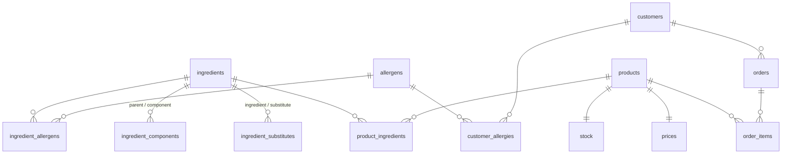

# Recipe and grocery service with allergens: data model of the five stores

The service suggests recipes that are **safe for the customer's allergies** and whose
**ingredients are in stock**. One program answers this question using five stores:

```
request text + customer id
        │
        ├─ PostgreSQL ── customer's allergy codes ─────────────┐
        ├─ pgvector / Qdrant ── similar recipes, allergens excluded by filter
        ├─ MongoDB ── the recipe documents (product ids, steps, nutrition)
        ├─ Neo4j ── every allergen reachable from those products + safe substitutes
        ├─ PostgreSQL ── can every product be bought now, total price
        └─ Redis ── the customer's cart (add the chosen recipe's products)
```

| Store | System of record? | Records |
|---|---|---|
| PostgreSQL | **yes**: business entities and decisions | 425 products, 425 stock rows, 425 prices, 500 customers, 420 allergy rows, 800 orders, 2 826 order items, 225 ingredients |
| MongoDB | **yes**: recipes (the flexible source documents) | 224 recipes |
| Redis | derived / session state | 300 carts |
| Neo4j | derived from PostgreSQL | 664 nodes, 697 relationships |
| pgvector, Qdrant | derived from MongoDB + Neo4j | 224 vectors each |

Data source: **synthetic**, generated by `grocery/generate.py` (seed 42) from the
hand-written catalog in `grocery/catalog.py`: 20 cuisines, 130 dish templates, 225
ingredients and the 14 EU allergens (Regulation 1169/2011, Annex II).

## One reason per store

- **PostgreSQL**: stock, prices, customers and orders need foreign keys, CHECK
  constraints and transactions, and the availability-and-price question is a join with aggregation.
- **MongoDB**: recipes are documents whose shape varies (steps as strings or as timed
  objects; nutrition per serving, per 100 g, or missing) and are always read whole.
- **Redis**: a cart is short-lived, per-customer session state that must expire after
  inactivity, which a key with a TTL does on its own.
- **Neo4j**: allergens hide at any depth (product → pesto → parmesan → milk), so
  "every allergen reachable" is a variable-length path query.
- **pgvector / Qdrant**: "a quick vegetarian dinner" is matched by meaning, not by
  keywords, so recipe descriptions are searched as embeddings.

## 1. PostgreSQL (relational, system of record)



Full DDL: [`sql/postgres_schema.sql`](../sql/postgres_schema.sql). Constraints:
`stock.quantity >= 0`, `prices.unit_price > 0`, `orders.status IN (...)`,
`customers.email UNIQUE`, and foreign keys on every link table.

**Required query:** can every product of a recipe be bought now, and at what total price?
(`grocery/queries.py`, `RECIPE_AVAILABILITY_SQL`)

```sql
WITH wanted AS (SELECT DISTINCT unnest(%(product_ids)s::text[]) AS product_id)
SELECT bool_and(coalesce(s.quantity, 0) > 0) AS can_buy_now,
       sum(p.unit_price)                     AS total_price,
       array_agg(w.product_id) FILTER (WHERE coalesce(s.quantity, 0) = 0) AS out_of_stock
FROM wanted w LEFT JOIN stock s USING (product_id) LEFT JOIN prices p USING (product_id);
```

## 2. MongoDB (document, system of record for recipes)

Collection `recipes`, created with a `$jsonSchema` validator, `validationAction: "error"`
(`grocery/load_mongo.py`). Required: `_id` (`R0001`), `title`, `cuisine`, `course`,
`preparation_minutes` (int), `product_ids` (non-empty array of `P0001`-style ids), `steps`.
`steps` items must be **either** a string **or** an object `{order, text, minutes}`.
An insert without `product_ids` fails with error code 121.

Two real documents (shortened):

```json
{ "_id": "R0010", "title": "Tiramisu", "cuisine": "italian", "course": "dessert",
  "preparation_minutes": 30, "product_ids": ["P0096", "P0069", "..."],
  "steps": ["Prepare the ingredients: ...", "..."],
  "nutrition": { "per_serving": { "kcal": 284, "protein_g": 15 } } }

{ "_id": "R0009", "title": "Minestrone Soup", "cuisine": "italian", "course": "soup",
  "preparation_minutes": 60, "product_ids": ["P0195", "P0035", "..."],
  "steps": [{ "order": 1, "text": "Prepare the ingredients: ...", "minutes": 15 }],
  "nutrition": { "per_serving": { "kcal": 682 } }, "equipment": ["stock pot", "baking tray"] }
```

Index `{product_ids: 1, preparation_minutes: 1}` (multikey) serves the
**required query**, recipes under 30 minutes that use a given product:

```js
db.recipes.find({ preparation_minutes: { $lt: 30 }, product_ids: "P0404" })
```

## 3. Redis (key-value, session state)

| Key | Type | Value | TTL |
|---|---|---|---|
| `cart:{customer_id}` | hash | `product_id → quantity`, plus `_updated_at` | 1 800 s, reset on every add/remove |

Source id = the customer id in the key; refresh time = `_updated_at`.
**Required operations:** `add` (`HINCRBY` + `EXPIRE`), `remove` (`HDEL` + `EXPIRE`),
`read` (`HGETALL`, does not extend the TTL). The cart expires after 30 minutes without changes.
(`grocery/cart.py`)

## 4. Neo4j (graph, derived from PostgreSQL)

```
(:Product {source_id, name, refreshed_at})
   -[:CONTAINS]->(:Ingredient {source_id, name, category, refreshed_at})
(:Ingredient)-[:CONTAINS]->(:Ingredient)           // composite: pesto -> parmesan
(:Ingredient)-[:HAS_ALLERGEN]->(:Allergen {code, name})
(:Ingredient)-[:CAN_BE_REPLACED_BY]->(:Ingredient)
```

Brand variants make the per-product graph necessary, for example
*Bella Cucina Basil Pesto with Cashews* reaches NUT, while the plain pesto does not.

**Required queries**, with the recipe's product ids and the customer's allergy codes as
parameters (`grocery/queries.py`):

```cypher
// every allergen reachable from the products
MATCH (p:Product) WHERE p.source_id IN $product_ids
MATCH (p)-[:CONTAINS*1..]->(:Ingredient)-[:HAS_ALLERGEN]->(a:Allergen)
RETURN collect(DISTINCT a.code) AS allergen_codes

// substitutes that contain none of the customer's codes
MATCH (p:Product)-[:CONTAINS]->(i:Ingredient) WHERE p.source_id IN $product_ids
MATCH (i)-[:CONTAINS*0..]->(:Ingredient)-[:HAS_ALLERGEN]->(a:Allergen) WHERE a.code IN $allergy_codes
WITH p, i, collect(DISTINCT a.code) AS allergens
OPTIONAL MATCH (i)-[:CAN_BE_REPLACED_BY]->(s:Ingredient)
WHERE NOT EXISTS { MATCH (s)-[:CONTAINS*0..]->(:Ingredient)-[:HAS_ALLERGEN]->(b:Allergen)
                   WHERE b.code IN $allergy_codes }
RETURN p.source_id, i.source_id, allergens, collect(s.source_id) AS safe_substitutes
```

Example output for *Classic Pesto Pasta* and a GLU + MLK customer: pasta → `rice_pasta`,
`chickpea_pasta`; parmesan → `nutritional_yeast`; pesto → *no safe substitute*.
Milk can be replaced by `oat_drink` for an MLK customer, but not for a GLU + MLK customer,
because oats reach GLU.

## 5. Vector stores: pgvector and Qdrant (derived from MongoDB + Neo4j)

Both stores hold the **same** vectors: `all-MiniLM-L6-v2` embeddings of
`title + ". " + description`, L2-normalised, 384 dimensions, cosine distance, HNSW
m = 16, ef_construction = 64.

| | pgvector: table `recipe_vectors` | Qdrant: collection `recipes` |
|---|---|---|
| id | `recipe_id text` (primary key) | UUIDv5 of the text id (Qdrant only accepts uint/UUID); text id in payload `recipe_id` |
| metadata | `cuisine`, `preparation_minutes`, `allergen_codes text[]`, `product_ids text[]`, `refreshed_at` | same fields in the payload |
| index | `hnsw (embedding vector_cosine_ops)` | HNSW; payload indexes on `cuisine`, `allergen_codes` (keyword), `preparation_minutes` (integer) |
| allergen filter | `WHERE NOT (allergen_codes && $codes)` | `must_not: [{key: "allergen_codes", match: {any: $codes}}]` |

`allergen_codes` is computed by the Neo4j traversal at load time, so the filter
uses the same answer as the graph.

**Required query:** recipes similar to a free-text request, where the SQL WHERE clause
and the Qdrant filter both exclude every code in the customer's allergy list
(`grocery/search.py`).

**pgvector answers it in one SQL statement joined with business tables**
(`PG_RECOMMEND_SQL`): customer allergies → vector search → stock → price.
**Qdrant needs three steps:** read allergies from PostgreSQL, run a filtered search in
Qdrant, then check stock and price in PostgreSQL.

```
$ python -m grocery.search "quick vegetarian dinner" --customer C0007    # allergies EGG, GLU, MLK, NUT
```
